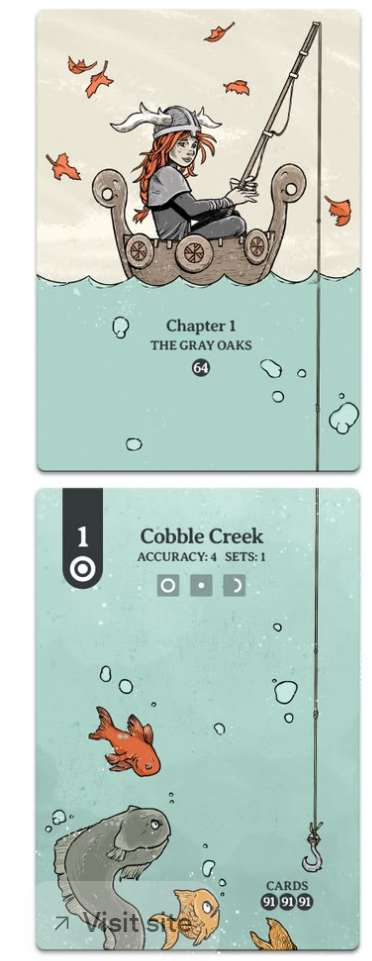

# Deepwater — Game Design Document

**Working title:** Deepwater. **Design baseline:** 6 November 2026.
**Status:** Agreed direction, subject to refinement and playtesting. Confirmed rules, leading concepts and illustrative examples are distinguished below. This is the gameplay source of truth; it does not claim implementation is complete.

## 1. Core vision

Deepwater is a skill-based fishing roguelike built around three interconnected mechanics:

- **Discover:** influence which creatures appear using a tag slot machine.
- **Land:** complete a short skill-based fishing challenge, generating Landing Points through accuracy and the current rig's synergies.
- **Build:** choose Catch or Bait, then commit the newly acquired creature to a position in an ordered rig.

Each successful encounter strengthens or changes the build for increasingly difficult creatures and deeper biomes. The central strategic challenge is building a powerful rig through irreversible positioning decisions. The central execution challenge is using that rig effectively during fishing encounters.

### Design pillars

- Every creature encounter is a challenge the player can win or lose.
- The rig is the main build-building mechanic; the landing challenge tests it.
- Skillful actions remain meaningful as rig bonuses and multipliers grow.
- Placement creates long-term commitments, immediate synergies and future opportunities.
- Abilities support distinct strategies, including landing performance, haul value and Technique interactions.
- Illustrated cards are the game world. Use Unity 2D and a tactile physical-card presentation without an animated player character or explorable sea.

Traditional combat and additional tactical landing decision systems are not planned. Voluntary surfacing, Line Capacity, line overload and line-break failure are not game mechanics. Catch acquisition requires successful landing.

## 2. Presentation and card roles

Large vertical illustrated cards communicate creatures, discoveries and depth. The visible rig connects attached creature cards and remains a central visual feature. Supplied illustrations and reusable card masters remain protected by the [card visual contract](../Card%20Visual%20Specification.md).

The reference supplies atmosphere and card presentation, not approval of every depicted control or statistic.

- **Creature cards:** encounter challenges and, after success, potential rig members with distinct Catch/Bait effects.
- **Technique cards:** strategic modifiers whose exact timing and redesigned effects are still to be determined. Access to the core loop must not depend on drawing a Technique.
- **Equipment:** build support and possible permanent progression rewards; categories and acquisition rules are under review.
- **Other encounter content:** events, treasure, authored chains and Apex content require compatibility review. Existing content is not automatically an approved completion gate, challenge bypass or extra failure system.

## 3. Expedition and encounter loop

Every new expedition starts in the first biome, **Shallows**, with an **empty rig**. Initially only Shallows is unlocked. Creatures collected during an expedition are temporary and never carry over as attachments into a future expedition; permanent unlocks and progression are preserved.

### Phase 1 — Discover: slot machine

Before the expedition, select exactly four of the eight supported tags in the Harbor. These are the three independent reels' equally likely symbols (25% each) throughout the expedition. After the initial spin, accept or lock exactly one reel and respin the other two once. The respun result is fixed and stays visible with further lock/respin input disabled. Only Accept Tags reveals the creature, whenever the player is ready; there is no automatic continuation or timeout.

Three different symbols permit any eligible biome creature with baseline rarity probabilities. A pair guarantees the repeated tag, prefers the third tag through increased species weight and improves higher-rarity chances modestly. A triple guarantees its tag and supplies a stronger rarity improvement, without guaranteeing Rare or Legendary. Roll rarity separately, then choose a suitable species. Missing rarity tiers fall back to the nearest available tier while preserving the guaranteed tag; equal-distance ties use the lower tier.

Normal creatures are eligible throughout their biome rather than by individual depth. Preserve creature unlock requirements and separate Apex conditions; standard slots exclude Apex. Missing guaranteed-tag coverage must be detected before finalizing an encounter, never bypassed with an unrelated creature. Active symbols do not restrict the entire biome pool. Discover does not grant Landing Points or acquire the creature. See the [complete slot specification](../Slot%20Machine%20Mechanic.md) for probabilities, boundaries and future-extension scope. Exact rarity probabilities and preference strength remain configurable balancing values.

### Phase 2 — Land: challenge

Reveal the creature with a **Resistance** target. Generate **Landing Points** through a skill-based fishing challenge using a limited number of attempts. The existing rig, active creature abilities, Techniques and equipment can enhance performance.

- Reach Resistance within the available attempts to succeed.
- If the target is not reached before attempts run out, fail the encounter and immediately end the expedition.
- The encountered creature is not yet acquired and supplies no newly attached rig benefits to its own landing.
- Success opens Catch/Bait choice and placement; failure does not acquire this creature.

### Phase 3 — Build: role and placement

After successful landing:

1. Choose **Catch** or **Bait** for the acquired creature.
2. Choose any permitted insertion position along the rig.
3. Commit placement. Existing creatures retain their relative order.
4. Recalculate positional and other ongoing synergies.
5. Continue automatically to the next encounter or biome progression step.

The new creature begins contributing after successful landing and placement, affecting future encounters. There is no per-encounter choice to surface. No additional manual Descend commitment is required by this loop. Exact role/position previews and confirmation remain UI work.

## 4. Landing challenge

The 13 November 2026 [Landing Challenge specification](../Landing%20Challenge%20Mechanic.md) defines the current baseline. Its numeric defaults remain prototype tuning; final creature abilities and artwork integration are separate work.

### Interaction and outcome

- A horizontal track contains an independently moving fish indicator and landing zone. The player controls neither element.
- Press **Space** or **STRIKE**. Evaluate overlap at the strike timestamp.
- A smaller centered **Perfect** region has priority over the wider **Good** region. A fish outside Good is a **Miss**. The supplied Miss wording is being clarified; the implementation uses no overlap with Good.
- Every strike consumes an attempt, including Miss. Initially use **four attempts**, configurable for balancing.
- Accumulate encounter-local Landing Points. Reach Resistance to succeed immediately, including on the final attempt; exhaust attempts below Resistance to fail immediately and end the expedition.
- Briefly freeze both indicators for accuracy/scoring feedback. Presentation does not delay authoritative success/failure or allow a duplicate strike.
- The zone follows a predictable oscillation. For now choose Steady, Burst or Erratic uniformly at random once per encounter. Burst is telegraphed; Erratic follows a learnable closed pattern with pauses. Species-specific behavior assignments are future content work.
- The current rig remains visible in committed order and cannot be rearranged. Only previously attached members contribute. The encountered creature cannot help land itself.

Region sizes, motion tuning and the boundary policy remain balancing inputs. The prototype treats touching an interval edge as overlap. No automatic success, traditional combat, health or separate tension resource is introduced.

### Difficulty progression

Resistance targets rise through the expedition. Creature characteristics and rarity may also influence difficulty. Increasing fish speed or shrinking the zone must not be the main escalation.

Rig growth should visibly increase results. Some abilities or upgrades may widen the landing zone or slow the fish, complementing score growth rather than simply erasing the main difficulty escalation.

### Skill and build balance

Timing determines action quality; the rig transforms that quality into a stronger result. Strong builds should make successful actions satisfying while preserving the value of accuracy. Different builds should achieve power through different interactions rather than every creature adding the same bonus.

## 5. Landing Points and scoring

The initial model is:

`Strike Landing Points = (Accuracy Base + Applicable Rig Bonuses) × Product of Applicable Rig Multipliers`

Prototype bases are **Miss 0 / Good 10 / Perfect 20**. Apply eligible flat bonuses before multiplying eligible multipliers. A normal Miss receives no ordinary successful-strike bonuses or multipliers; an explicit Miss scoring ability is required to change that behavior. Retain fractional scores in the current prototype rather than assigning a final integer-rounding policy. Each strike resolves and adds its score once, with source attribution for feedback. Points reset at the next encounter and are not sale value, Gold or permanent progression.

These numbers and the final numeric precision/rounding/special interactions remain open to balancing. Existing creature lists do not gain illustrative scoring abilities automatically. Catch/Bait effects and their positional conditions must be explicitly authored; both roles participate in neighboring/contiguous tag conditions unless excluded.

Possible ability directions include flat bonuses, multipliers, additional attempts and special scoring interactions. Each exact effect needs an approved trigger, target, duration and limits. Additional attempts are a possible ability type, not a universal purchase during landing.

The player should understand how a skillful strike becomes a visibly stronger result, with satisfying combinations comparable in spirit to Balatro's build growth.

## 6. Ordered rig and placement

The rig is an ordered sequence of attached creatures, in either Catch or Bait role.

- Insert a newly acquired creature at any permitted position.
- Committed creatures cannot be manually rearranged.
- Insertion never changes existing creatures' relative order.
- Some abilities may restrict later insertion positions.
- Positional effects update dynamically when creatures attach or are removed.
- Both Catch and Bait participate in adjacency and tag synergies unless an ability explicitly excludes a role.
- Position means current rig order; distinguish it from acquisition time and runtime instance identity.

No maximum rig size is established. Removing Line Capacity does not authorize a replacement slot limit. Handling a placement state with no permitted position is open and must be decided before introducing an ability that can create it. Restriction interactions, orientation and exact effect timing require precise wording.

### Catch and Bait

Only the selected role's effects operate.

- **Catch:** contributes resolved sale value and may provide utility or synergy.
- **Bait:** contributes zero sale value but may supply stronger effects or positional support. It remains attached rather than being automatically consumed.

Neither role must have a positional effect. The tradeoff is haul value versus build utility and placement consequences. Positional mechanics belong within some Catch/Bait abilities, not a universal third ability layer.

## 7. Creature ability design

Ground effects in creature behavior, anatomy or ecology. Support simple creatures as well as synergy engines. Avoid adding complexity to every creature or making Landing Points every creature's sole contribution.

Abilities may improve landing, haul value, Technique interactions or other supported aspects of the rig. Exact effects and values need redesign; existing serialized effects are not the redesigned content specification.

### Illustrative Mackerel — not finalized

- **Catch:** gain +5 value for each other contiguous Schooling creature connected to Mackerel in either direction.
- **Bait:** each other contiguous Schooling creature adds +3 Landing Points to successful strikes.

Both roles can participate unless finalized text excludes one. These examples do not finalize counting boundaries, stacking between multiple Mackerel, trigger order or numbers.

### Illustrative Anchored creature — not finalized

An ability might prevent future creatures from being inserted before its source while doubling the Catch value of creatures before it. This combines a strong reward with a placement restriction. It is not an automatic property of the Anchored tag. Exact behavior and balance remain open.

### Tags and properties

Retain the established vocabulary as the content review starting point: **Fish, Predator, Schooling, Small, Heavy, Anchored, Armored, Elusive**. Tags support readable synergies and may express movement characteristics; they do not grant automatic abilities.

The purpose of **Weight** and **Heavy** needs reevaluation. Weight has no capacity, overload or line-break role. Do not assign Resistance from Weight or automatically rename Weight to Resistance: Resistance is a challenge target. No creature/tag assets are removed or renamed by this documentation change.

See [Creature Ability Design](../Creature%20Ability%20Design.md) for authoring and review scope.

## 8. Removal and release

Removal changes rig composition and positional synergies. Release may become strategically important, but its access, timing, restrictions, costs, triggers and effect-lifetime rules need reevaluation.

This baseline grants no universal free Release, free role switch, manual reorder or challenge skip. It does not finalize retained abilities that might grant these actions. Before approving removal, define source-dependent effects, completed triggers, newly adjacent creatures and insertion restrictions.

Expedition failure imposes no loss or reduction of accumulated Catch sale value. Release access and the value consequences of deliberately removing a creature still require their own rules; end-of-expedition cleanup is not a deliberate Release action.

## 9. Biomes and expedition progression

- Only **Shallows** is initially unlocked.
- Completing a biome permanently unlocks the following biome.
- Every expedition begins in Shallows; traverse earlier biomes to reach later unlocked ones.
- Failure ends the expedition without reversing permanent biome unlocks.
- Failure awards the full accumulated sale value of previously attached Catch creatures; the failed creature is not acquired and Bait contributes zero.
- Success must grant meaningful rewards beyond unlocking the next biome.

Biome length, completion criteria, pacing, biome count, expedition success conditions and what happens after the last available biome remain open. No particular Apex, encounter count or terminal placeholder is an approved completion condition. Whether a newly unlocked biome is entered in the same expedition also needs specification.

Biomes should provide meaningful creature and build variety. Earlier-biome repetition is a playtest risk; allowing deeper starts would conflict with the agreed start rule.

### Expedition failure, success and haul rewards

- Every expedition begins with an empty rig. Collected creatures are temporary expedition build components.
- Failing a Landing Challenge immediately ends the expedition. The failed encounter's creature is not acquired.
- On failure, award the full accumulated sale value of all previously attached Catch creatures, as if the haul had been returned successfully. No accumulated Catch value is lost because of failure.
- Successful expedition completion also awards the full accumulated Catch sale value. Success and failure use the same full-value haul payout rule.
- Bait creatures have zero sale value on either outcome.
- Preserve the resolved haul value for payout before clearing the rig. All attached creatures are removed when the expedition ends, regardless of success or failure; they do not become a permanent creature inventory.
- Every subsequent expedition begins with an empty rig while permanent unlocks and progression remain preserved.
- Successful completion may additionally unlock biomes, equipment, creatures available in future expeditions, or other permanent progression rewards. Unlocking creature availability does not carry over an attached creature.

The full-value payout rule is decided. Currency identity, conversion details and the exact additional completion rewards remain open. Neither voluntary surfacing nor Line Capacity is part of the design.

### Rewards and permanent progression

Possible completion rewards include equipment/upgrades, creatures becoming available in future expeditions, additional gameplay options, special unlocks and achievements. These are candidate categories, not a reward table.

Gold-based purchases are not guaranteed to remain the main progression system. Full accumulated Catch sale value is awarded at expedition end on both success and failure; whether Gold is used and how value is represented or converted remain open. Successful expeditions should feel more rewarding through additional completion/progression rewards, not by withholding Catch value on failure.

Achievement unlocks are under consideration. Illustrative objectives: capture 25 Schooling creatures across expeditions; capture five unique Predator creatures in one expedition. These do not finalize counting, targets, rewards or requirements. Existing Journal objectives require review; surfacing and overload objectives are not active requirements.

## 10. Equipment and Techniques

### Equipment

Review all equipment against the new encounter, scoring and rig systems. Rod, Reel and Hook can remain as categories; roles and loadout rules need reconsideration. Existing prices, purchase rules and permanent equipment ownership are not finalized progression.

Individual effects need approval. Weight-, capacity- and overload-related effects need redesign. See [Equipment Passive Rules](../Equipment%20Passive%20Rules.md).

### Techniques

Evaluate compatibility with landing. Techniques may influence points, attempts, accuracy or other strategic interactions. Exact play windows, effects, durations, deck composition and access remain to be determined. Capacity-, weight-, overload- and surfacing-based effects need redesign.

Do not carry forward challenge bypasses or arbitrary play windows merely because a Technique exists. Do not add energy, a turn system, mandatory per-strike card play or automatic refills without approval. Existing deck behavior is implementation reference, not finalized balance.

## 11. Other encounter mechanics

Events, treasure, encounter chains, concealment, replacements and Apex behavior need review against Discover → Land → Build. A reward effect must not silently grant an unchallenged creature where the core loop requires landing one.

Frequency, place in the sequence, Technique windows and completion implications remain open. Preserve separate presentation/data categories while those rules are designed. Do not invent extra tactical landing phases or combat. See [Event Rules Implementation Tasks](../Event%20Rules%20Implementation%20Tasks.md).

## 12. Validation priorities

| Risk | What playtesting must establish |
| --- | --- |
| Repetition | Landing remains enjoyable across many encounters. |
| Skill versus build | Accuracy matters and rig decisions substantially improve results. |
| Difficulty | Resistance creates pressure without relying mainly on speed or tiny zones. |
| Creature variety | Learnable movement and abilities produce distinct encounters. |
| Rig complexity | Positioning offers strategy without every creature becoming complicated. |
| Earlier biomes | Mandatory traversal remains worthwhile after deeper unlocks. |
| Completion rewards | Additional completion/progression rewards make success worthwhile while both outcomes pay full accumulated Catch value. |
| Balance | Powerful combinations do not consistently trivialize future challenges. |

A focused playtest can evaluate proposed controls, attempt counts or formulas without making them final. Production work must keep authored tuning and runtime state separate and deliver complete clean increments.

## 13. Open decision register

| Area | Decisions still required |
| --- | --- |
| Slot machine | Exact rarity probability tables and secondary-tag preference strength; no extra landing connection. Rules are specified in the Slot Machine Mechanic supplement. |
| Landing | Confirm the supplied Miss wording; final zone widths, boundary policy, attempts, movement tuning and feedback balance. Space/button strikes, graded overlap and immediate terminal outcomes are specified. |
| Scoring | Final base values, numeric precision/rounding/limits and special interactions. Initial flat-before-product model, ordinary Miss-zero rule and source attribution are specified. |
| Difficulty | Resistance curves, rarity/characteristic influence and skill/build balance. |
| Rig | Orientation, restriction combinations, no-legal-position handling and effect order. |
| Creature content | Redesigned Catch/Bait effects, numbers, durations, tags and movement. |
| Weight and Heavy | Whether retained and for what purpose. |
| Release and role changes | Access, timing, targets, costs, triggers, lifetimes and placement consequences. |
| Techniques | Windows, effects, deck/hand/draw configuration and progression. |
| Equipment | Category roles, effects, loadout, acquisition and ownership. |
| Biomes | Completion, length, transitions, unlock entry timing and expedition success endpoint. |
| Rewards | Additional biome/expedition rewards, currency representation/conversion and whether Gold remains; both success and failure already award full accumulated Catch sale value at expedition end. |
| Achievements | Whether used, counting, grants and persistence. |
| Other encounters | Events, treasure, Apex, chains, concealment and replacements. |
| Presentation | Slot/landing layouts, Resistance display, weight fields and insertion feedback. |

Resolve these through explicit design decisions and playtesting. Examples and existing assets do not fill the gaps automatically.
