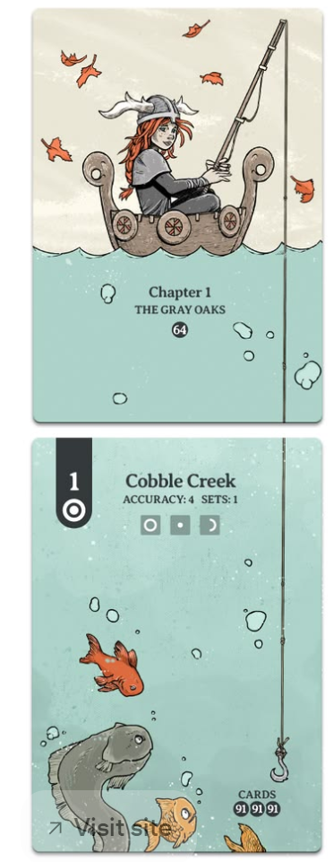

> **One-sentence concept**
>
> A cards-only fishing roguelike where the player descends through increasingly valuable waters, builds a risky chain of catches on the fishing line, and decides when to stop pushing deeper and surface with the haul.

**Status:** Early design. This document captures the mechanics and
direction currently agreed upon; values, balance, exact card counts, and
content are intentionally not final.

# 1. Design pillars

- Cards are the game world. The presentation should feel like a physical
  illustrated card game on a screen, not a conventional game with cards
  layered on top.

- Push-your-luck is the emotional core. Every additional catch and every
  deeper step should make the player ask whether to keep going or cash
  out.

- The catch chain is a temporary build. Caught creatures remain
  mechanically relevant during the descent instead of becoming instant
  currency.

- Weight creates pressure. Valuable catches increase line load, and
  greed should create dangerous but tempting states rather than a simple
  hard inventory limit.

- The deck defines how the player fishes. Basic fishing actions are
  always available; the hand contains techniques that modify, exploit,
  or bend those actions.

# 2. Visual and presentation direction

**The game contains no animated character, explorable sea, or
traditional world view.** Everything important is represented by cards:
the boat/start state, ocean encounters, creatures, treasure, the catch
chain, and the player's techniques.

- Large vertical illustrated cards are the main visual language.

- The fishing line visually connects the boat/start card to caught
  creature cards below it.

- Artwork carries most of the atmosphere and sense of depth; surrounding
  UI should stay restrained.

- Cards should feel collectible and tactile, with clear names, small
  amounts of readable information, and strong illustration.

- Depth and danger can be communicated through card art, card pools,
  labels, and increasingly strange encounters rather than animated
  scenery.

## Visual reference

The provided reference captures the intended feeling: illustrated
vertical cards, a visible fishing line, minimal UI, and the sense that
the card itself contains the world.

# 3. Card architecture

The design uses three functional card groups. This resolves the main
concern about whether the hand should contain creatures or actions.

| **Card / element**     | **Role**                                                        | **Example effect**                                                                                                                                                                        |
|------------------------|-----------------------------------------------------------------|-------------------------------------------------------------------------------------------------------------------------------------------------------------------------------------------|
| Core action cards      | Always available; not shuffled into the deck.                   | Descend, Release, Surface. Encounter commitment happens automatically unless a technique intervenes.                                                                                      |
| Player technique cards | The 4-card hand and build/deckbuilding layer.                   | Bait, reinforced knots, special hooks, descent modifiers, risk manipulation, catch manipulation.                                                                                          |
| Encounter cards        | Drawn/generated by the game according to the current situation. | Creatures, treasure, hazards, environmental situations, opportunities, and unusual discoveries. Catchable creature encounters become Hooked and move into the Catch Chain when committed. |

## Why this split

- The player never becomes unable to perform a fundamental fishing
  action because the correct card was not drawn.

- The hand still matters because technique cards determine how
  efficiently, safely, or unusually the player fishes.

- Ocean creatures remain discoveries rather than choices presented like
  items in a shop.

- Deckbuilding represents the player's fishing strategy, while the catch
  chain represents the temporary state of the current descent.

# 4. Core actions

The game is structured around **actions**, not a separate turn system. A core action resolves one meaningful decision. **Descend** advances the expedition, **Release** changes the Catch Chain without advancing, and **Surface** ends the descent. Technique cards modify these actions or the current encounter.

| **Core action** | **Purpose**                                                                                                                   | **Design rule**                                                                                                                                                                                                            |
|-----------------|-------------------------------------------------------------------------------------------------------------------------------|----------------------------------------------------------------------------------------------------------------------------------------------------------------------------------------------------------------------------|
| Descend         | Move deeper and commit the current Hooked card to the Catch Chain in its selected Catch or Bait role unless a technique card avoids, redirects, or replaces it. | Always available. Descending is the default way to accept the current card and continue. Only the selected Catch/Bait effect set activates. Technique cards can alter how far or how safely the player descends, or allow the player to pass an encounter without taking it. |
| Release         | Drop a previously caught creature or item from the line.                                                                      | Reduces load immediately, forfeits any Catch-role haul Value, and ends ongoing attached effects. Completed one-time triggered effects are not automatically undone. Release does not advance the descent; the player remains at the current depth and must still resolve the current encounter afterward. |
| Surface         | End the descent and attempt to bring the remaining catch home.                                                                | Everything that successfully returns becomes the player's haul and can be sold/used in progression.                                                                                                                        |

## 4.1 Encounter commitment and Hooked state

Creature encounters are not freely accepted or skipped. When a catchable
creature appears, it becomes the current Hooked encounter. Unless the
player uses a technique or special effect to intervene, continuing the
descent commits that card to the Catch Chain.

- Encountered: the card has been revealed and its information/effect is
  visible according to the current rules.

- Hooked: the creature is attached to the rig as the current unresolved
  encounter. This is the player's reaction window.

- Attached: before Descend, the player selects the Hooked card's Catch
  or Bait effect. When committed, the card records that role and becomes
  a permanent part of the current Catch Chain. Only the selected role's
  effects activate. Bait-role cards remain visible in the chain with a
  distinct marker. Both roles contribute their resolved Weight to Line
  Load. Catch-role cards contribute their resolved Value to the final
  haul; Bait-role cards contribute zero haul Value.

- There is no free universal Skip action. Avoiding an unwanted catch
  requires a technique card, equipment effect, creature effect, or
  another specific rule.

- This allows creatures with meaningful downsides to matter. The ocean
  can give the player an inconvenient catch that must be managed rather
  than simply declined.

# 5. Core run loop

1.  Begin the descent with an empty Catch Chain and a small hand of
    technique cards.

2.  Use Descend to move through deeper encounter pools and advance the
    expedition.

3.  Reveal an Encounter card based on depth, biome, current catches, and
    active modifiers. A catchable creature becomes the current Hooked
    encounter.

4.  Use technique cards during the reaction window to manipulate the
    Hooked encounter, avoid or replace it, change its consequences,
    prepare the line, or alter the next descent.

5.  If the player Descends without an avoidance/replacement effect, the
    Hooked creature is automatically committed to the Catch Chain in its
    selected Catch or Bait role before the next encounter is reached.

6.  The new attached card increases Line Load and only its selected role's
    passive or downside effects may immediately change the run.

7.  Choose whether to keep descending, release an existing catch to
    reduce load or remove its effect, or surface with the current haul.

8.  On surfacing, all surviving cards still attached to the line become
    the haul.

9.  Sell/use the haul, improve equipment/deck options, then begin
    another run.

<table>
<colgroup>
<col style="width: 100%" />
</colgroup>
<thead>
<tr class="header">
<th>
<strong>Core question</strong>

How much value and synergy can I keep hanging from this line before
greed makes the return trip too dangerous?
</th>
</tr>
</thead>
<tbody>
</tbody>
</table>

# 6. Catch chain

Caught creatures do not immediately disappear into an inventory. They
stay attached to the fishing rig while the player continues descending.
The vertical chain of caught cards is both a visual record of the run
and a mechanical system.

- A catchable encounter normally enters the chain by default when the
  player continues descending; avoiding it requires a specific technique
  or effect.

- Every attached card contributes its resolved Weight to Line Load. Catch-role
  cards contribute their resolved Value to the haul; Bait-role cards contribute
  zero haul Value.

- Many caught cards can provide passive effects while they remain
  attached.

- Existing catches can influence what appears next, creating a temporary
  engine during the descent.

- The player is rewarded for assembling useful interactions, but every
  additional catch makes the line harder to manage.

- Releasing a card removes its Weight, any Catch-role haul Value, and ongoing
  attached effects. Completed one-time triggered effects are not automatically
  undone by releasing their source.

## Creature interaction principle

Creature and creature-like Apex cards use a closed gameplay tag vocabulary: **Fish**, **Predator**, **Schooling**, **Small**, **Heavy**, **Anchored**, **Armored**, and **Elusive**. These tags exist to support readable synergies and targeting rules. Biological taxonomy, rarity, card type, flavor, role, and runtime state should not be added as creature tags; those concepts belong in their dedicated data or presentation fields. A card may have multiple applicable tags.

Creatures can join or interact with the line for different thematic reasons:

- Predators may be attracted to previously caught prey.

- Squid and octopus can be attracted to struggling prey, grab a catch,
  or tangle with the rig.

- Crabs or similar creatures can cling to catches or the line.

- Jellyfish or debris may become entangled.

- Treasure and objects can be snagged by the rig.

- Some creatures may alter the value, weight, attraction, or behavior of
  other cards in the chain.

The goal is thematic plausibility, not strict simulation, while supporting
a wide range of creature behaviors and interactions.

## Catch and Bait Effect Design

These guidelines govern creature effect authoring across biomes, including
Coastal Waters creature YAML. They define design principles, not a finalized
card set or an implementation catalog.

### Role tradeoff

Both Catch and Bait remain attached until released or surfaced; Bait is not
temporary by default. Each role contributes the card's full resolved Weight
to Line Load, including any explicitly authored weight modifiers. Only the
selected role's effect set activates, if it has effects.

- **Catch:** contributes its resolved sale Value when successfully surfaced.
  Its main purpose is collecting value with modest utility or synergy.
- **Bait:** contributes zero haul Value even when successfully surfaced.
  Its main purpose is sacrificing sale value and occupying capacity for
  greater utility, build potential, or tactical advantage.

The central decision is: “Do I spend limited Line Capacity on profit or
on power?” The design target is: **Catch builds the haul; Bait builds the
engine.**

### Effect design principles

1. **Thematic grounding:** Connect both effects to the creature's anatomy,
   behavior, appearance, or ecological role. Ink, camouflage, venom, shells,
   spines, gripping tentacles, schooling, and anchoring are useful inspirations.
2. **Mechanical freedom:** Catch and Bait can serve entirely different
   strategic purposes. They need not share a target, statistic, or trigger.
   Numerical pairs such as Catch granting Predators +2 Value and Bait granting
   +5 Value are occasionally valid, but should not define the card set.
3. **Bait generally stronger:** Zero sale value and full load should usually
   buy greater utility or build potential. Stronger need not mean a larger number.
4. **Interesting tradeoffs:** Either role should sometimes be right depending
   on the Catch Chain, Line Load, depth, technique hand, and desired build.
5. **Build synergy:** Favor meaningful interactions with creatures and the
   closed tag vocabulary above over universal, always-good bonuses. Tags
   connect creatures; not every effect must explicitly mention a tag.
6. **Downsides allowed:** Catch effects may be inconvenient or risky, with
   high sale value compensating. Effects need not all be beneficial.
7. **Deliberate simplicity:** Common creatures may have no Catch effect,
   no Bait effect, or only one simple effect. Do not add complexity for its own sake.
8. **Distinctiveness:** Mix straightforward cards, synergy cards, and surprising
   effects rather than many small variations of Value, Weight, or attraction.
9. **Persistent power needs limits:** Early attachments can affect many
   encounters. Prefer conditional, tag-specific, or situational power over
   unlimited universal bonuses.
10. **Preserve core decisions:** Effects should enrich Catch/Bait choice,
    Catch Chain management, Line Load, Release, Descend, Surface, and technique
    play rather than routinely bypassing them.

Possible design directions include Catch Chain manipulation, information
reveal, encounter control, Release interactions, effective Weight changes,
conditional bonuses, and distinctive downsides. Ability copying and role
changes are also exploratory directions. These directions do not authorize
unspecified mechanics: each proposed effect needs precise rules and design
approval before becoming finalized content.

### Effect behavior and timing

Distinguish ongoing attached effects from effects that resolve at a specific
moment. Only the selected role supplies its effects.

- **Persistent example:** “Small catches gain +3 Value while attached.”
  The bonus ends when its source is released.
- **Triggered example:** “When caught, reveal the next two encounters.”
  A completed reveal is not undone by releasing its source. This example
  illustrates lifetime, not a finalized encounter-preview mechanic.

Releasing either role removes its Weight and ongoing attached effects.
Releasing Catch also forfeits its haul Value; Bait already has zero haul
Value. Completed one-time triggered effects are not automatically undone
when their source is released. Explicit effect rules must define any
continuing dependency on the source.

Candidate trigger moments include commitment as Catch or Bait, Descend,
another creature's commitment, Release, entering a depth zone, and Surface.
Define each effect's timing, target, duration, and Release interaction.
If an effect refers to role assignment, specify whether it means selecting
a Hooked role or committing the card; selecting a panel must not be assumed
to resolve a commitment effect. Avoid “next creature” unless it clearly means
the next encountered, Hooked, or committed creature. Trigger examples are
not a promise that all such behaviors are currently implemented.

### Illustrative effect pairs

These examples illustrate variety and simplicity. They are not finalized
card effects, balance values, or approval to implement new systems. Target
selection, timing, duration, and interactions must be specified before use.

| Creature | Catch example | Bait example | Design intent |
|----------|---------------|--------------|---------------|
| Small Octopus | **Grip:** Reduce another attached catch's effective Weight by 1. | **Tentacle Trick:** When releasing a creature, choose the next encounter from two revealed options. | Load efficiency versus encounter control. The choice mechanic requires defined selection and encounter rules. |
| Cuttlefish | **Ink Cloud:** Hide the next encounter. | **Mimicry:** The next caught creature copies an attached creature's effect. | An information downside versus combinations. Concealment duration and copying eligibility, role, trigger, lifetime, and stacking require exact rules. |
| Snapper | **Fresh Prey:** Predators become slightly more common while attached. | **Blood Trail:** Predator encounters become significantly more common while attached. | A valid occasional numerical pair; not the default for the whole set. |
| Sea Bass | No effect; keep normal sale Value. | **Live Prey:** Predator encounters become more likely. | Deliberate simplicity; not every common creature needs two abilities. |

### Creature effect quality checklist

Before accepting a card design, check:

- Both effects, if present, fit the creature's characteristics or theme.
- Catch and Bait offer distinct strategic reasons to choose them; a numerical
  pair is a deliberate occasional exception.
- Bait is generally compelling enough to sacrifice sale value and carry
  the creature's full resolved Weight.
- Catch remains attractive in plausible game states.
- Timing, target, duration, and Release interactions are understandable.
- The card interacts meaningfully with creatures or tags, or fills a useful
  simple role.
- Line Load and Catch Chain decisions remain meaningful.
- Rules text is short enough for the supplied Catch and Bait effect panels.
  Compact Catch Chain cards retain their existing visual contract and do
  not gain full rules text.

## Approved creature refactor: Cleaner Shrimp

Cleaner Shrimp is a Coastal Waters creature: Weight **1**, Value **8**, rarity
**Uncommon**, inclusive depth range **1–14**, and tag **Small**. Its previous
weight-reduction effect is replaced by the two role effects below.

### Catch — Quick Clean

**Card text:** “Remove one negative effect.” Immediately after commitment as
Catch, the player chooses one active lasting or temporary negative effect
created by a card and affecting the run, another card, or Line Load. Remove
that exact runtime occurrence completely; if none is eligible, do nothing.

Eligible effects include ongoing attached effects, pending effects, and
lasting stat modifiers already applied to a card. Removing a lasting modifier
reverses that modifier's own contribution while preserving other modifiers.
Authored negative-effect classification identifies eligible card effects;
normal base Weight and overload are not themselves effects to remove.
Completed actions such as revealing information are not undone. Cleansing
one effect does not remove its source card, alter its other effects, affect
other copies, or modify shared card definitions. The removal remains resolved
if Cleaner Shrimp is later released.

### Bait — Cleaning Station

**Card text:** “At later biome starts, swap a Catch for one of two creatures.”
Automatically trigger once at the start of each later biome visit while this
Bait attachment survives. Do not trigger in the biome where it was attached.
Resolve multiple Cleaner Shrimp in Catch Chain order, one after another.

1. Snapshot eligible creature Catch attachments before entering the biome.
   Bait cannot be selected. A replacement created during this entry is not
   eligible for another swap during the same entry.
2. Reveal two distinct non-Apex creatures eligible in the new biome's normal
   starting-depth pool, using normal encounter weights. Offers do not consume
   normal encounters, advance encounter chains, or alter repetition history.
   Skip if no eligible Catch survives or fewer than two distinct creatures
   can be offered.
3. The player chooses an eligible Catch and one offered replacement. Remove
   the old attachment and end its ongoing effects. This replacement is a swap,
   not a Release action, and does not trigger Release reactions.
4. Attach the replacement as Catch with its normal starting Weight and Value,
   without inheriting the old attachment's modifiers. Activate its Catch
   on-attach effect, if any, before resolving the next Shrimp. Both normal
   persistent interactions and the replacement's own Catch effects apply.
5. Finish biome-entry choices before drawing the new biome's first normal
   encounter. The Catch Chain, Line Load, technique deck, and run state
   otherwise continue across the boundary.

Biome destinations are authored links, not invented content. Coastal Waters
currently has no authored destination biome; its next-waters presentation
remains the boundary until that content is provided.

## Approved creature refactors: Clinging Crab and Cod

**Clinging Crab** — Coastal Waters, Weight **2**, Value **14**, Uncommon,
depth **0–12**, tags **Anchored, Armored**.

- **Catch / Iron Grip:** cannot be deliberately released by the core action,
  Techniques, or creature abilities. Forced removal and exchanges can still
  remove it. The restriction applies only in the Catch role.
- **Bait / Claw Cut:** immediately after attachment, the player chooses one
  other legally releasable attached Catch or Bait and releases it immediately.
  This is a deliberate Release caused by a creature effect and can trigger
  Release reactions. Resolve once; skip without a legal target and never save
  the unused release for later.

**Cod** — Coastal Waters, Weight **2**, Value **12**, Common, depth **3–20**,
tags **Fish, Predator**. **Catch has no effect.**

**Bait / Bottom Feeder:** while attached, the first deliberate Release of
another attached **Armored creature**, in either role, offers one discarded
Technique to return to hand. The player chooses after the entire releasing
Technique or ability finishes, including the Technique just used. An empty
discard pile recovers nothing but still consumes the opportunity. All Cod
Bait copies share **one opportunity per encounter**; replacing the current
encounter does not reset it. Forced removals and exchanges do not trigger it.
A completed trigger survives later removal of its source during that ability.

Used Techniques enter discard before resolving their effects. Their normal
hand refill waits for resulting recovery choices to finish, then fills only
up to the normal hand size. Recovery itself does not discard or cap excess
hand cards; every recovered card remains accessible in the hand UI.

An explicitly empty Catch or Bait role remains effectless. It must not copy
another role's text or effects. Legacy role fallback exists only for creature
cards that have not yet received their approved refactor.

## Approved creature refactors: Garfish, Glass Minnow, and Jellyfish

All three are Common Coastal Waters creatures.

**Garfish** — Weight **1**, Value **9**, depth **0–9**, tags **Fish, Small, Elusive**.

- **Catch / Swift:** gains +3 sale Value per other attached creature that is
  Elusive and in Catch mode. Bait and non-creature cards do not count.
  Recalculate whenever eligible creatures or their effective tags change.
- **Bait / Slipstream:** every other attached Fish creature, in either role,
  gains Elusive while this source remains attached as Bait. Newly attached Fish
  receive the grant before their on-attach and other attachment-triggered effects.
  Multiple grants never duplicate tags. Ending a grant preserves native tags and
  tags still supplied by another active source.

**Glass Minnow** — Weight **1**, Value **5**, depth **0–15**, tags
**Fish, Small, Schooling**. **Catch has no effect.**

**Bait / Shoal Signal:** after another Schooling creature is attached as Catch
and its on-attach effects finish, while a Minnow Bait remains attached, the player
may discard one Technique from hand and draw exactly one replacement. This is a
redraw, not playing the discarded card. An empty hand or declining does nothing.
The choice is immediate and cannot be saved. Multiple Minnow Bait copies offer
only one redraw per eligible attachment. The normal deck/discard reshuffle rules
apply, including the just-discarded card when the draw pile is empty.

**Jellyfish** — Weight **1**, Value **8**, depth **0–18**, tag **Small**.

- **Catch / Tangle:** on attachment, queue +1 effective Weight for the next other
  creature attached as Catch. Bait attachments do not consume it. The pending
  effect survives Jellyfish removal and multiple pending Tangles add together.
  Once applied, the extra Weight lasts until the recipient leaves the chain,
  including if its mode later changes. Pending and applied penalties remain
  removable negative effects for Quick Clean.
- **Bait / Buoyant Bell:** immediately choose up to two distinct other attached
  Armored creatures, in either role. Reduce each selected creature's Weight by 1
  (minimum 0) while this source remains attached as Bait and that target remains
  attached and Armored. Losing Armored suspends its reduction; regaining Armored
  restores it. Target role changes do not end the reduction. Freeze targets once:
  unused selections and removed targets cannot be replaced. Multiple Jellyfish
  can select the same creature; reductions stack and clamp at zero.

Rebuild effective attached tags from runtime/native base tags and surviving grants
before calculating tag-dependent statistics and attachment triggers. Do not mutate
shared card definitions. Attachment exchanges create a new creature Catch, consume
eligible pending Tangles, and resolve on-attach effects before Shoal Signal; they
still do not count as Releases.

## Approved creature refactors: Lionfish, Mackerel, and Moonlit Ray

All three are Coastal Waters creatures. Only the selected role's effects operate.

**Lionfish** — Weight **2**, Value **30**, Rare, depth **10–20**, tags **Fish, Predator, Armored**.

- **Catch / Venomous Spines:** each deliberate Release of another attached creature in either role removes 5 current sale Value, minimum 0. Each creature released by a multi-release action causes its own penalty. The loss persists until this Lionfish leaves the chain, including across mode changes. Do not accumulate debt below zero. Forced removals and exchanges do not trigger it.
- **Bait / Venomous Lure:** after a Predator is attached as Catch and its on-attach effects finish, optionally Release one other attached Small creature in either role. Exclude the Predator just caught and obey normal Release restrictions. Successful removal is a deliberate creature-effect Release and triggers other Release effects. All Lionfish Bait copies share at most one Release opportunity per Predator attachment. No legal target or declining skips it immediately; it cannot be saved.

**Mackerel** — Weight **1**, Value **10**, Common, depth **0–16**, tags **Fish, Schooling**.

- **Catch / Packed Shoal:** effective Weight is exactly 0 while at least two other Schooling creatures are attached as Catch. Bait does not count. Recalculate immediately as eligible creatures, roles, or effective tags change.
- **Bait / School Call:** on this card's first Bait attachment, immediately offer up to two distinct non-Apex Schooling species eligible at the next encounter's biome and depth, using normal encounter weights. Choose one to replace the next normal draw, or decline. One eligible species is a valid offer; with none, draw normally. Selection does not reveal the encounter or advance depth; reveal at normal time with normal on-reveal effects. Scheduled Apex encounters cannot be replaced.
- School Call activates once per card; mode and biome changes do not refresh it. The decision cannot be saved. One selection can be queued: a new selection replaces the earlier one, while declining leaves it intact. Removing the source does not cancel its selection. Revalidate at the actual next destination; an ineligible selection is discarded and the normal draw is used.

**Moonlit Ray** — Weight **3**, Value **24**, Rare, depth **9–20**, tags **Fish, Predator, Elusive**.

- **Catch / Graceful Glide:** reduce effective Weight by exactly 1, minimum 0, while any Elusive creature is attached as Bait. Additional Elusive Bait do not increase the reduction. Eligibility updates immediately with creatures, roles, and tags. This follows the approved detailed resolution and stacking rule; the short description is normalized to the same flat reduction.
- **Bait / Moonlit Reflection:** each deliberate Release of an Elusive Catch records its sale Value, including modifiers, immediately before that individual removal. After the entire Release action finishes, choose a remaining Catch and add the recorded amount as a lasting Value bonus. Forced removals, exchanges, and released Bait do not trigger it.
- All Ray Bait copies share one transfer per released Elusive Catch. Multi-release actions record and transfer each separately. Resolve recipient choices immediately after the action; no remaining Catch skips the transfer. A completed trigger survives later source removal during the action. The bonus lasts until recipient removal, survives original Ray removal and recipient mode changes, and still contributes no sale Value while the recipient is Bait.

# 7. Line load and overload

Weight is the main pressure system. The current working term is Line
Load.

<table>
<colgroup>
<col style="width: 100%" />
</colgroup>
<thead>
<tr class="header">
<th>
<strong>Example display</strong>

LINE LOAD 11 / 10 - OVERLOADED
</th>
</tr>
</thead>
<tbody>
</tbody>
</table>

- Each catch has a weight/load contribution.

- Equipment defines a safe line capacity.

- Going above capacity is allowed. Overload should increase danger
  instead of causing an immediate automatic failure.

- The further above capacity the player goes, the more dangerous certain
  actions can become: continuing to descend, catching another heavy
  creature, or beginning the return/surface process.

- Descend and Surface perform a break check while overloaded. The chance
  increases with each point of excess Line Load.

- If the break check succeeds, the line breaks and the run ends. The
  player loses a random number of attached catches from one up to half of
  the Catch Chain, selected randomly without replacement.

- A line-break ending uses the normal accelerated Surface ascent. The
  surviving Catch Chain remains visible during the ascent, then becomes
  the final haul.

- If the check holds during Descend, the run continues while overloaded.
  If it holds during Surface, the full attached Catch Chain is retained.

- This creates intentional greed states where the player knows the rig
  is unsafe but may still chase one more valuable encounter.

# 8. Releasing catches

Release is the pressure valve for the load system, but it must remain
costly enough that overload still matters.

- The player can release a caught creature/item while still descending.

- Released cards immediately reduce Line Load.

- The player permanently loses a released Catch-role card's end-of-run Value.
  Bait-role cards already contribute zero haul Value.

- Ongoing attached effects, attraction modifiers, and source-dependent synergies
  from that card end immediately. Completed one-time triggered effects are not
  automatically undone; any continuing dependency must be defined by the effect.

- Release is not a free inventory operation. Choosing Release does **not**
  advance the descent. The player stays at the current depth, the current
  Hooked encounter remains unresolved, and the player must still decide how
  to deal with that encounter afterward.

- This means a low-value creature can still be painful to release if it
  is enabling an important build interaction.

# 9. Depth and encounters

- Depth is a central progression axis within a run.

- Different depth bands use different Encounter card pools, with deeper
  areas tending toward rarer, stranger, heavier, and more valuable
  encounters.

- Descend is always available as a core action; the deck contains cards
  that modify descent rather than gate it.

- Encounter probabilities can be influenced by bait, current catches,
  technique cards, equipment, and potentially location/biome.

- The ocean should feel like a discovery system: the player manipulates
  encounter conditions and can prepare answers to bad catches, but does
  not freely choose or reject every creature that appears.

## Encounter deck composition

A biome should not be a simple stack of creature cards. The game uses an
Encounter Deck: creatures are only one category of encounter. This keeps
each region active and prevents the repeated decision pattern of “catch
or skip another fish.”

- Creature cards: fish, squid, crabs, predators, and other catchable sea
  life.

- Treasure and salvage cards: cargo, artifacts, wreckage, pearls, and
  other valuable objects.

- Environment cards: currents, reefs, murky water, vents, weather, and
  other conditions that change the current situation.

- Opportunity cards: schools of fish, migrations, feeding frenzies,
  unusual signals, and other temporary advantages.

- Hazard cards: snags, sudden load problems, predators, damaged rigging,
  and other complications.

- Rare or special encounters: unusual creatures, major discoveries,
  mini-boss-style catches, and memorable one-off events.

- Biome-specific cards: encounters that exist mainly to express the
  unique mechanic and identity of that region.

## Biome identity

Each biome should introduce a recognizable gameplay idea, not merely
different artwork and higher-value fish. Entering a new region should
change how the player thinks about the catch chain, risk, or encounter
deck.

- An introductory coastal biome can emphasize schools and simple
  predator attraction.

- A reef biome can emphasize snags, attachments, and interactions
  between caught cards.

- Open ocean can emphasize predators and intentionally carrying smaller
  prey as bait.

- A twilight/deeper biome can emphasize incomplete information and
  uncertain encounters.

- Deep-sea regions can emphasize very heavy catches and unusual load
  manipulation.

- Late-game abyssal regions can deliberately bend established rules with
  strange creature effects.

## Internal progression within a biome

A region should have enough room for the player to experience it before
moving on. To achieve this without requiring an enormous amount of
unique content, each biome can contain several depth tiers whose
encounter pools overlap and evolve.

- Shallow tiers introduce the biome with safer and more common
  encounters.

- Middle tiers add the biome’s core hazards, opportunities, and
  strategic interactions.

- Deep tiers phase out common cards and introduce predators, rare
  rewards, heavier catches, and major encounters.

- Cards can enter and leave the pool gradually rather than every biome
  using one fixed shuffled deck.

This means repeat cards are acceptable when the surrounding state
changes the decision. A Sardine can remain interesting if its low
weight, predator-attraction effect, current Line Load, and the player’s
technique hand create a different reason to keep or release it.

## Biome Apex Encounters

Each biome ends with a special **Biome Apex Encounter**: a rare creature,
treasure, or other major encounter that does not normally appear in the
biome's standard encounter pools. It acts as the climax of that region
and marks the transition into the next biome.

- Apex Encounters should be high-value and mechanically significant, not
  simply larger versions of ordinary creatures.

- Catching an Apex creature can introduce a powerful passive effect that
  changes how the rest of the run is played while that card remains in
  the Catch Chain.

- The reward should usually come with pressure. Apex catches can be very
  heavy, have a downside, or otherwise make continuing into the next
  biome more dangerous.

- The player carries the Apex catch and its consequences into the next
  biome. Entering a new region does not reset the Catch Chain or Line
  Load.

- Apex Encounters should use the same core language as the rest of the
  game rather than becoming traditional combat bosses. The important
  question remains whether the player can afford to keep the encounter
  attached to the line.

- A biome can have multiple possible Apex Encounters, with one selected
  for a particular run. A working target is roughly 2–4 Apex variants per
  mature biome so repeated visits do not always end with the same climax.

The intended feeling is that an Apex catch is simultaneously a
**legendary reward, a temporary run-changing build component, and a new
source of risk**. Catching one should make reaching the next biome feel
exciting rather than simply advancing to a new card pool.

## Encounter chains

Some encounter cards can form short card-only sequences that create a
sense of discovery and mini-stories without animation or a traditional
environment. For example, an ambiguous signal may lead to a shadow and
then to a predator; wreckage may lead to a sunken wreck and then to a
choice of salvage paths.

- Encounter chains should create different choices than ordinary
  creature encounters, not merely delay the reveal of a reward.

- They are especially useful for rare moments, biome landmarks, major
  creatures, and treasure discoveries.

## Content and repetition target

The design should seek systemic replayability rather than solving
repetition only by producing hundreds of unique fish. A working early
content target for a mature biome is roughly 25–35 encounter designs,
with only a subset appearing in any one visit and with different depth
tiers drawing from different subsets. This number is a planning target,
not a locked requirement.

- Roughly 10–15 creature designs.

- Roughly 4–6 environment or hazard designs.

- Roughly 3–5 treasure or opportunity designs.

- Roughly 3–4 rare or special encounters.

- Roughly 1–2 major encounters or biome-defining moments in the regular encounter pool.

- Roughly 2–4 possible Biome Apex Encounter variants, with one used as the biome climax in a given run.

The important measure is decision variety: Encounter Card + Catch
Chain + Line Load + Depth + Technique Hand should combine to make
repeated cards produce different decisions.

# 10. The player deck

The player holds approximately four technique cards. After a technique
card is used, a replacement is drawn according to the final deck rules.

- Technique cards represent bait, special hooks, knots, rigging tricks,
  line reinforcement, descent modifiers, encounter manipulation, and
  other fishing methods.

- The deck should create distinct fishing strategies rather than simply
  provide larger numbers.

- Cards should interact with depth, Line Load, creature tags, the catch
  chain, and risk.

- Fundamental actions should remain outside the deck so bad draws create
  interesting limitations, not basic-function lockouts.

- Some technique cards should specifically provide escape valves for
  mandatory catches: bypassing a Hooked creature, replacing it,
  neutralizing a downside, or releasing it more efficiently.

# 11. Run economy and progression

- Value is realized primarily after the player surfaces, not immediately
  when a creature is caught.

- Only catches still attached/successfully returned become part of the
  haul.

- The haul can be sold for gold and can support later progression such
  as equipment improvements, new cards, deck upgrades, and unlocks.

- Long-term progression should expand strategic possibilities rather
  than only increase raw power.

# 12. Intended player tension

<table>
<colgroup>
<col style="width: 100%" />
</colgroup>
<thead>
<tr class="header">
<th>
<strong>Target feeling</strong>

"I should surface now... but I can probably handle one more
catch."
</th>
</tr>
</thead>
<tbody>
</tbody>
</table>

The strongest decisions should come from conflicts between value,
weight, and synergy. A creature can be worth keeping because it is
expensive, because it enables another creature, because it improves
encounter odds, or because it supports the current deck. Releasing a
card should therefore feel like dismantling part of the run, not merely
cleaning inventory space. The player should also sometimes be forced to
absorb an inconvenient creature and decide whether to build around it,
spend a scarce technique to avoid it, release another catch, or surface
early.

# 13. Prototype scope

The first prototype should test the signature loop before adding a large
content or meta-progression layer.

- 3 permanent core actions: Descend, Release, Surface. Hooking and catch
  commitment are automatic parts of encounter resolution rather than a
  separate basic Catch action.

- A 4-card technique hand and a small technique deck.

- A small Encounter deck/pool with roughly 15–20 cards across creatures,
  hazards, opportunities, treasure, and at least one short encounter
  chain.

- At least 2–3 downside creatures that are undesirable in some states,
  plus several technique cards that let the player bypass, replace,
  cleanse, or otherwise manage a Hooked encounter.

- A visible vertical catch chain.

- One Line Load / capacity system with overload risk.

- Simple passive effects on selected catches.

- A few depth bands with different encounter pools.

- A basic end-of-run haul and sell screen.

- Prototype specifically for decision variety: repeated creature cards
  should still create different choices because of current load,
  catch-chain effects, depth, and the player hand.

<table>
<colgroup>
<col style="width: 100%" />
</colgroup>
<thead>
<tr class="header">
<th>
<strong>Prototype success criterion</strong>

Is it fun to build an increasingly valuable and mechanically useful
catch chain while deciding whether to release something, keep
descending, or surface?
</th>
</tr>
</thead>
<tbody>
</tbody>
</table>

# 14. Still open / not locked

- Exact overload probability tuning and loss-count balance within the
  locked one-to-half loss range.

- Whether physical position/order in the catch chain has rules of its
  own (for example, only releasing the lowest catch freely). This is
  promising but should be prototyped before being treated as core.

- Exact number of cards drawn, deck size, discard/shuffle rules, and
  card rarity structure.

- How locations/biomes are selected between runs or during a run.

- How much meta-progression is permanent versus run-specific.

- Exact biome length, depth-tier count, encounter-pool size, and how
  many encounters a typical visit should contain before moving to the
  next region.
