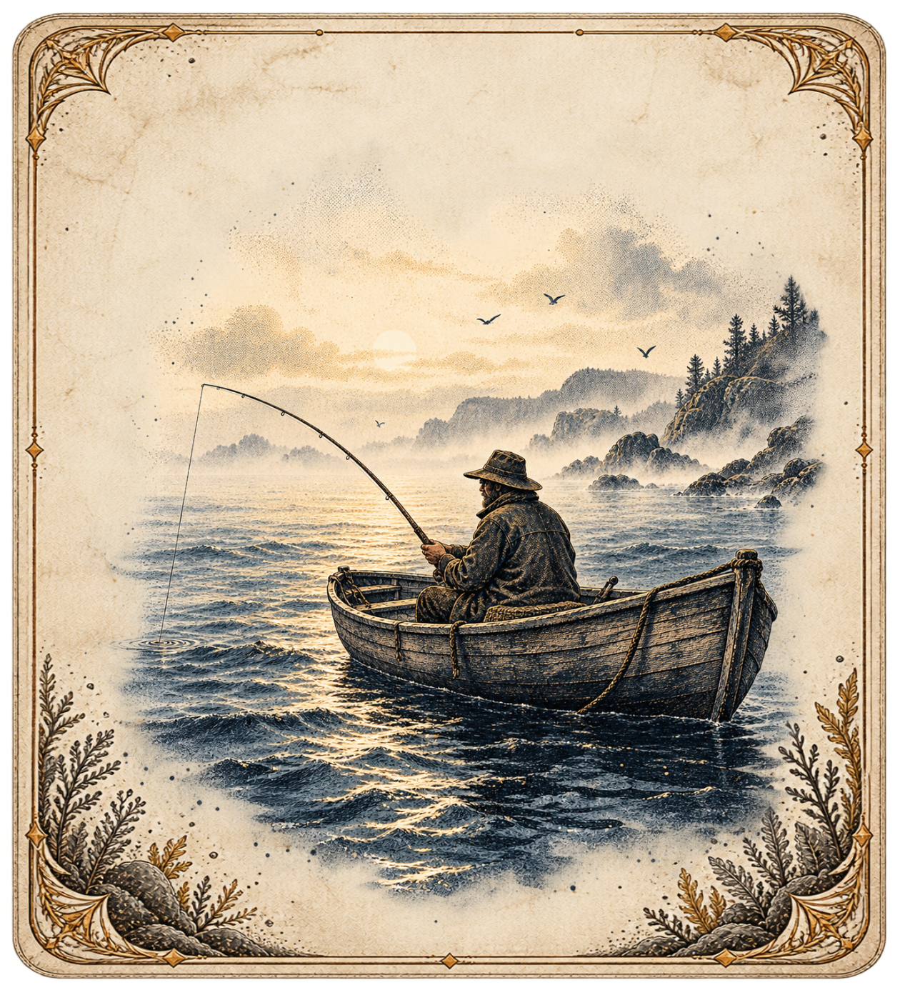

> **Imported and verified at [MFJ-SYNC-005](../../Sync005/README.md). No remaining Unity import work.** Original design-only notes below are historical.

# MFJ-R039 — Opening boat card

Status: ready for review; **not integrated into Unity**.

An art-only1260×1400 card intended for the beginning of the run, before the first creature. A fisherman casts from a small wooden skiff, surrounded by engraved coastal water and an aged ivory botanical frame. No title, stats, sale value, effects or Catch/Bait panels appear on the card.

The frame and scene are separate original PNG sources and separate Penpot layers, not slices of a mockup. The scene preserves its original proportions; the decorative housing fits the target card footprint. Review labels sit outside the card and must not be exported into the game.

Penpot page: Concept B — Reusable Assembly (4K). Board: MFJ-R039 / Run opening / fisherman boat card. Exact native IDs, source dimensions, hashes and illustration bounds: [PenpotDesign.json](PenpotDesign.json). Original generation prompts: [GenerationPrompts.json](GenerationPrompts.json).

Sources: [frame](OpeningBoatFrame.png), [illustration](FishermanBoatIllustration.png). These are new assets generated from the established creature-card style reference. Frame1073×1466; scene1179×1334; assembled card1260×1400.

Future import must create a candidate-theme opening presentation, without inventing a new creature, event, technique, deck member or gameplay effect. No gameplay timing or action changes were implemented now. Keep the editable separation and dynamic game card contracts intact.

All candidate Unity asset files are hash-identical to the pre-edit snapshot: [preservation](UnityPreservation.json). Existing32 verified imports and4 superseded drafts are unchanged; R037/R038/R039 are pending.
