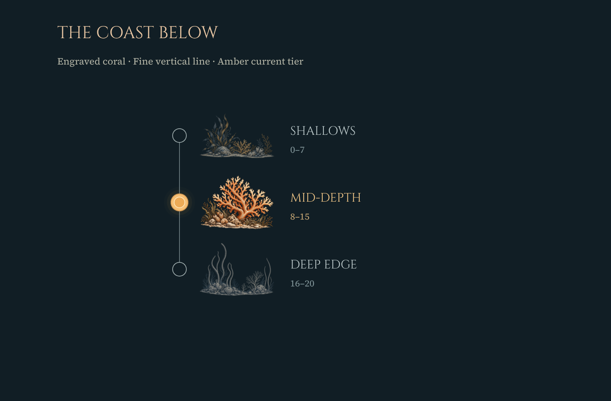

> **Imported and verified at [MFJ-SYNC-005](../../Sync005/README.md). No remaining Unity import work.** Original design-only notes below are historical.

# MFJ-R040 — Illustrated depth guide

Status: **ready for review, not integrated into Unity**.

Recreates the original static mockup’s visual approach: restrained vertical rule, hollow inactive nodes, small engraved seabed/coral illustrations and an amber current-tier node, halo and label. No surrounding metal housing. The guide replaces the previous text block in the new Gameplay F comparison assembly; previous boards are preserved.

The mockup used illustrative labels Reef and Deep Water. This design retains the actual Coastal Waters names and ranges: Shallows0–7, Mid-depth8–15 and Deep Edge16–20. Depth12 selects Mid-depth. The preview’s coral imagery is decorative; active state must be driven independently by current depth. The marker and label communicate the current tier even when a vignette includes warm ink.

Penpot page: Concept B — Reusable Assembly (4K). Boards: Gameplay F / Illustrated depth guide / MFJ-R040 and MFJ-R040 / Depth guide / mockup-style coral timeline. Exact native IDs, layers and source hashes: [PenpotDesign.json](PenpotDesign.json). Guide760×550 at gameplay-relative(2840,1130). Three new transparent images, each1448×1086, displayed205×153.75 without distortion. Labels, ranges, connecting line and node/halo geometry are native editable elements. Nothing was cut from the mockup.

Generated with the built-in imagegen tool using the original mockup as style reference. [Prompts](GenerationPrompts.json). Sources: [shallows](shallows.png), [reef](reef.png), [deep water](deep_water.png).

Future Unity work: selectively import these sources into the isolated candidate theme; update HUD construction and tier presentation. Use the actual biome’s authored tiers, ranges and current depth, with a layout accommodating different tier counts and long names. Do not hardcode the preview’s three rows, depth12 or labels into gameplay. Preserve current actions, pending alternatives and input behavior; no new mechanics are introduced.

[Native verification](Verification.json) checks editable tier content, geometry, active state, hidden previous labels and in-context placement. [Unity preservation](UnityPreservation.json) verifies all290 candidate asset files remain byte-identical. No Unity edits, prefab imports or runtime changes were made. Pending revisions areR037–R040; completed/superseded history remains unchanged.
